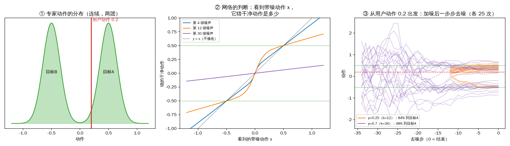
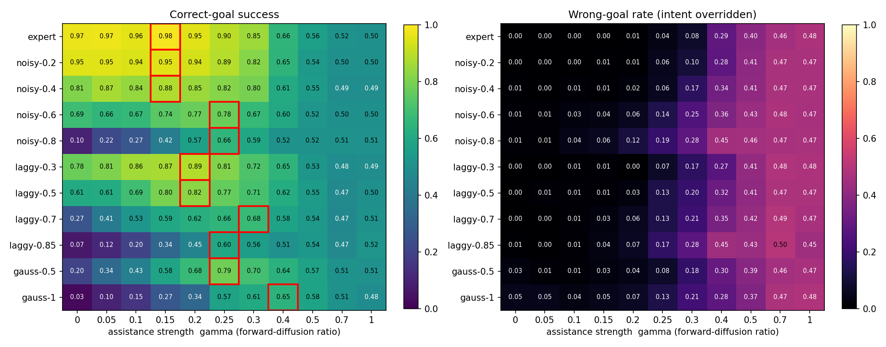
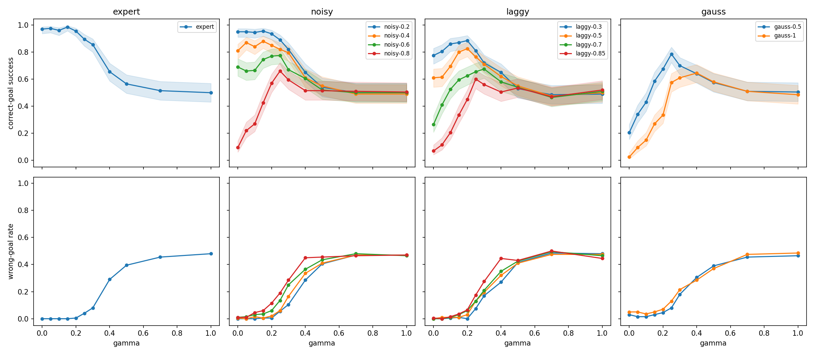
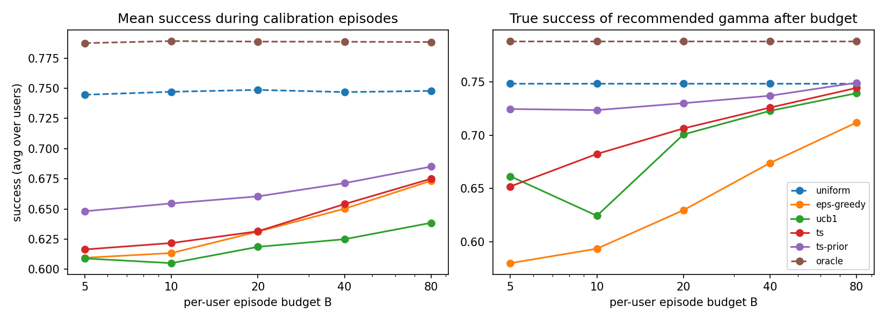

# Robot-Learning-Course-Final-Project

## Shared Autonomy：从固定辅助强度走向个性化辅助

| | |
|---|---|
| **复现论文** | Yoneda et al., *To the Noise and Back: Diffusion for Shared Autonomy*, RSS 2023（[arXiv:2302.12244](https://arxiv.org/abs/2302.12244)） |
| **官方实现** | [ripl/diffusion-for-shared-autonomy](https://github.com/ripl/diffusion-for-shared-autonomy)：提供专家示范、预训练扩散模型、SAC 专家和模拟用户评测 |
| **最小复现** | 在 `BlockPushMultimodal-v1` 上，比较无辅助和不同固定辅助强度 γ 下，各种模拟用户的任务成功率和用户目标保持情况 |
| **第一轮问题** | 不同模拟用户是否需要不同的辅助强度？如果最优强度几乎相同，个性化的空间就很有限 |
| **后续选题** | 面向 EMG 等噪声输入：辅助强度能否随用户、随时间自适应？（见第 3 节和 `proposal/main.pdf`） |

**一句话结论**：最优辅助强度确实因人而异，并且随用户误差增大而增大；但各用户的最优区间重叠很多，统一 γ=0.25 已拿到大部分收益，个性化只多约 2–4 个百分点，主要好处是避免对熟练用户过度干预。

---

## 1. 方法：扩散模型怎么做 Shared Autonomy

### 1.1 问题设定

**Shared autonomy**：人和机器共同决定机器人最终执行的动作。人提供意图，机器修正操作误差。

可以把用户的每一个动作看成两部分：

> **用户动作 = 用户意图（想把方块推到哪个目标） + 操作误差（手抖、延迟、误操作）**

机器侧（copilot）的任务是**去掉误差、保留意图**。难点在于：环境观测里**没有目标信息**，机器不知道用户想去哪个目标，用户意图只能通过用户动作传达。

### 1.2 核心想法：给用户动作加一个"学出来的滤波器"

论文的做法是：先给用户动作**加噪**，把操作误差淹没进高斯噪声里；再用扩散模型**去噪**，把动作拉回"专家会做的动作"。

扩散模型只在专家数据上训练过，它眼中的"噪声"就是"和专家动作不一样的部分"。所以去噪时，用户误差会被当成噪声一起去掉；而用户意图（大方向）只要没被噪声盖住，就会被保留。论文标题 *To the Noise and Back*（推进噪声里，再拉回来）说的就是这个过程。

**辅助强度 γ 决定加多少噪声，也就是人和机器之间的控制权怎么分**：

> γ 大 → 加噪步数 k 大 → 噪声多 → 能修掉更大的用户误差 → 机器自主程度高

| γ | 谁说了算 |
|---|---|
| 0 | 完全由人控制，不辅助 |
| 小 | 人决定大方向，机器修细节 |
| 大 | 机器主导，用户输入几乎被忽略 |
| 1 | 完全由机器控制：从纯噪声生成专家动作，不管人想去哪 |

**关键权衡**：噪声应该**刚好盖住用户误差**。

- 加得太少：误差比噪声还大，修不掉；
- 加得刚好：误差被去掉，意图保留；
- 加得太多：意图也被盖住，机器只能在两个目标里随便挑一个，**推到错误目标**。

所以辅助能起作用的前提是：**用户误差要比用户意图"小"**，不能大到让意图本身混淆。误差越大的用户，需要越大的 γ。

### 1.3 直观例子（1 维连续动作）



（由 `scripts/denoise_toy.py` 生成）专家动作是连续的两团：+0.5 附近对应目标 A，−0.5 附近对应目标 B。用户想去目标 A，但手不准，给出的动作是 0.2。

- **图②：网络怎么"猜"。** 看到带噪动作后，网络猜"原本干净的动作是多少"。噪声中等时（橙线），离哪一团近就猜哪一团；噪声很小时（蓝线），基本不改；噪声很大时（紫线），看不出原来是哪团，只能猜中间。
- **去噪每一步 = "猜一次、挪一点"**：新动作 = c₁ × 猜的干净动作 + c₂ × 当前动作 + 小随机数。越接近结束，c₁ 越大。
- **图③：γ 的效果。** γ=0.25 时，84% 被拉回用户想去的 +0.5；γ=0.7 时，用户信息被噪声冲掉，结果约一半去了错误目标。

### 1.4 两个阶段：训练（离线一次）与辅助（在线每步）

**训练（官方已完成，本项目直接使用其权重）**

1. **数据**：用 SAC 专家把方块推向 `target`，记录每一步的（状态 s，专家动作 a）。收集时 40% 的步骤执行随机动作，让机器人走到各种偏离的状态，但记录的永远是专家动作。再把数据**镜像翻转**，得到推向 `target2` 的数据。所以训练数据里**只有专家，没有用户**，动作分布是双峰的。
2. **加噪**：对每个样本随机选一个噪声等级 t（0–49）和正态随机数 ε，一步算出带噪动作：
   ã = √ᾱ_t · a + √(1−ᾱ_t) · ε。状态 s 保持干净。
3. **网络**：4 层全连接 MLP（9 → 128 → 128 → 128 → 9，softplus 激活）。t 通过每层一张查表向量逐元素相乘输入，共约 3.5 万参数。输入是 [s, ã] 和 t，输出是对噪声 ε 的估计 ε̂。
4. **损失**：L = ‖ε − ε̂‖²。网络从而学会"在状态 s 下，干净动作大概在哪"。看到的值减去它认为的干净值，就是噪声。
5. **设置**：batch 4096，Adam（lr 1e-3），30,000 步。

噪声表：50 个 β 按 sigmoid 曲线从 1e-4 增长到 0.26，表示每一步加多少噪声；ᾱ_t = (1−β₁)…(1−β_t)，表示加 t 步后原信号还剩多少。

**辅助（推理阶段，网络参数固定，机器人每走一步做一次）**

```
输入：当前状态 s、用户动作 a_h、辅助强度 γ
1. k = ⌊49γ⌋                                     # γ=0 时直接执行 a_h
2. 加噪到第 k 级：ã = √ᾱ_k · a_h + √(1−ᾱ_k) · ε
3. 去噪 k 次（t = k−1, …, 0）：
       ε̂ = 网络([s, ã], t)                       # 猜噪声
       ã ← 往"猜的干净动作"挪一步，再加一点小随机数
       状态部分始终钉回真实 s
4. 执行 ã
```

和普通扩散生成（从纯噪声开始）不同，这里**从部分加噪的用户动作开始**，所以结果既受用户影响，又被拉向专家分布。实现见 `sha_exp/core.py` 中的 `assist()`，与官方 `DiffusionAssistedActor` 一致。

---

## 2. 第一轮实验：不同用户需要不同的 γ 吗？

### 2.1 设置

**模拟用户**（`sha_exp/users.py`）：都是同一个 SAC 专家（推向 `target`）加上不同的操作误差。

| 用户 | 误差类型 | 等级 |
|---|---|---|
| `expert` | 无误差 | – |
| `noisy-ε` | 以概率 ε 输出随机动作（偶发误操作，同论文 NoisyActor） | 0.2 / 0.4 / 0.6 / 0.8 |
| `laggy-p` | 以概率 p 重复上一步动作（反应延迟，同论文 LaggyActor） | 0.3 / 0.5 / 0.7 / 0.85 |
| `gauss-σ` | 专家动作加高斯抖动（手抖，额外增加） | 0.5 / 1 |

- **辅助强度**：γ ∈ {0, 0.05, 0.1, 0.15, 0.2, 0.25, 0.3, 0.4, 0.5, 0.7, 1.0}
- **评测**：每个（用户, γ）跑 200 回合，每回合最多 100 步，结果记为：
  - `correct`：方块进入用户目标（成功）；
  - `wrong`：进入另一个目标（意图被覆盖）；
  - `timeout`：超时，没到任何目标。
- **配对设计**：第 i 回合在所有 γ 下使用同一个随机种子（初始场景、用户误差、扩散噪声都相同），不同 γ 之间是配对比较。
- **统计**：bootstrap 置信区间；个性化收益另用 2-fold cross-fitting（一半回合选 γ、另一半评估）去除选择偏差。

**复现验证**：

- 论文表 II（BlockPush，噪声水平 0.6，γ=0.2，每格 300 回合，± 为 95% 置信区间）：

  | | noisy 无辅助 | noisy 有辅助 | laggy 无辅助 | laggy 有辅助 |
  |---|---|---|---|---|
  | 论文 | 62.3% | 75.7% | 42.0% | 74.3% |
  | 本项目 | 63.3 ± 5.5% | 73.3 ± 5.0% | 44.7 ± 5.6% | 75.7 ± 4.9% |

  表 II 的设定（噪声 0.6、γ=0.2、3 个种子 × 100 回合）是从官方仓库的原始结果表 `table_analysis/summary/BP-*.csv` 反推出来的。
- γ=0.4 时专家用户正确率 0.66（官方表格 58/100）；γ ≥ 0.5 时正确与错误目标接近 50/50，与官方结果一致。

### 2.2 结果

共 11 用户 × 11 γ × 200 回合 = 24,200 回合。数据在 `results/`。



| 用户 | 无辅助 γ=0 | 最优 γ* | 成功率 @γ* | γ* 被选为最优的概率 | 与最优等价的 γ | 统一 γ=0.25 下 | 个性化增益 |
|---|---|---|---|---|---|---|---|
| expert | 0.97 | 0.15 | 0.985 | 0.56 | 0 – 0.2 | 0.895 | +0.090 |
| noisy-0.2 | 0.95 | 0.15 | 0.955 | 0.34 | 0 – 0.2 | 0.890 | +0.065 |
| noisy-0.4 | 0.81 | 0.15 | 0.880 | 0.51 | 0.05 – 0.25 | 0.820 | +0.060 |
| noisy-0.6 | 0.69 | 0.25 | 0.775 | 0.47 | 0.15 – 0.25 | 0.775 | 0 |
| noisy-0.8 | 0.10 | 0.25 | 0.660 | 0.91 | 0.2 – 0.3 | 0.660 | 0 |
| laggy-0.3 | 0.78 | 0.2 | 0.885 | 0.55 | 0.1 – 0.2 | 0.810 | +0.075 |
| laggy-0.5 | 0.61 | 0.2 | 0.825 | 0.70 | 0.15 – 0.25 | 0.765 | +0.060 |
| laggy-0.7 | 0.27 | 0.3 | 0.675 | 0.59 | 0.15 – 0.3 | 0.655 | +0.020 |
| laggy-0.85 | 0.07 | 0.25 | 0.600 | 0.74 | 0.25 – 1 | 0.600 | 0 |
| gauss-0.5 | 0.20 | 0.25 | 0.785 | 0.98 | 0.25 | 0.785 | 0 |
| gauss-1 | 0.03 | 0.4 | 0.645 | 0.72 | 0.25 – 0.5 | 0.575 | +0.070 |

| 设置 | 11 个用户平均成功率 |
|---|---|
| 无辅助（γ=0） | 0.497 |
| 统一最优强度（γ=0.25） | 0.748 |
| 每人用自己的最优 γ（上限） | 0.788（比统一高 +0.040，95% CI [+0.029, +0.066]） |
| 去除选择偏差后（cross-fitted） | 比统一高 **+0.018**，95% 区间 [+0.002, +0.039] |



### 2.3 结论

1. **最优 γ 因人而异，且随用户误差增大而增大**：低误差用户约 0.15，中等约 0.2–0.25，高误差用户 0.3–0.4。这符合"噪声要刚好盖住误差"的理解。注意：论文附录的 γ × 噪声扫描里已经能看到这个趋势，这一点不是本项目的新发现。
2. **但最优区间宽、重叠多**：大多数用户的近似最优集合都包含 0.2 或 0.25。统一 γ=0.25 已把平均成功率从 0.50 提升到 0.75。
3. **个性化空间存在但有限**：只多约 2–4 个百分点，去除选择偏差后约 +1.8 个百分点。收益集中在**低误差用户**：统一的 γ=0.25 对专家辅助过强，成功率从 0.98 降到 0.90，因为机器开始把方块推向错误目标。
4. **意图被覆盖决定了 γ 的上限**：γ ≥ 0.3 后错误目标率迅速上升，γ ≥ 0.5 时所有用户都退化到约 50/50。
5. **误差大到接近意图时，辅助失效**：noisy-0.8、laggy-0.85、gauss-1 即使用最优 γ，成功率也只有 0.60–0.66。
6. **偶发误差和持续误差影响不同**：noisy-0.2（20% 的步随机）不辅助也有 0.95 成功率，偶发抽动会被后续正常动作抵消；真正有害的是频繁或持续的误差（noisy-0.8、laggy-0.85）。

---

## 3. 后续选题（Proposal）：面向 EMG 输入的自适应辅助强度

正式版本见 `proposal/main.pdf`（CoRL 模板，源码 `proposal/main.tex`）。

### 3.1 动机与研究问题

设想用 sEMG 腕带（例如 Meta 手环）控制机械臂：状态好时解码出的指令接近本意；用久了，疲劳、腕带移位会让指令变得抖动、延迟。机器人应该在指令变差时多帮一点，在用户很准时少插手，否则会把方块推向用户不想去的目标。

论文的 γ 对所有用户、所有时刻都是同一个固定值。我们要回答：

- **Q1**：用真实 EMG 解码误差校准的模拟用户，个性化的空间是否比论文的简单噪声用户更大？
- **Q2**：每一步调整 γ 的 RL 策略，能否在成功率和意图保持上同时超过固定 γ？
- **Q3**：当用户的噪声在一次使用中逐渐变化（疲劳、电极移位）时，自适应能比固定 γ 好多少？

### 3.2 已有初步结果

- 论文表 II 已复现（见 2.1）；24,200 回合的 γ 扫描显示，统一 γ=0.25 只比每人最优低约 1.8 个百分点（见 2.2–2.3）。
- **按回合做 bandit 校准不划算**。`scripts/bandit_sim.py` 把每个用户看成一个多臂老虎机：每个 γ 是一个臂，跑一回合得到一次"成功/失败"反馈，回合结果从第一轮数据中离线重放：



| 策略 | 校准期间平均成功率 B=5 | B=20 | B=80 | 预算后推荐 γ 的真实成功率 B=5 | B=20 | B=80 |
|---|---|---|---|---|---|---|
| uniform（统一 γ，留一法） | 0.745 | 0.749 | 0.748 | 0.748 | 0.748 | 0.748 |
| eps-greedy | 0.610 | 0.631 | 0.673 | 0.580 | 0.630 | 0.712 |
| ucb1 | 0.609 | 0.619 | 0.639 | 0.661 | 0.701 | 0.739 |
| ts（Thompson sampling） | 0.616 | 0.632 | 0.675 | 0.652 | 0.706 | 0.744 |
| ts-prior（人群先验） | 0.648 | 0.660 | 0.685 | 0.725 | 0.730 | 0.749 |
| oracle（上限） | 0.787 | 0.789 | 0.788 | 0.788 | 0.788 | 0.788 |

（B 为每个用户的回合预算。）80 回合内，从零开始的校准都比不过统一 γ；加入人群先验能缩小差距，但仍未超过。我们的解释是：论文的模拟用户太简单，低估了真实输入的多样性；而且按回合做选择太粗，一个回合只有一个"成功/失败"信号。

### 3.3 和已有工作的区别

- **按用户调整辅助**不是新想法：Gopinath et al. 2017 按用户优化辅助参数，Nikolaidis et al. 2017 研究人机相互适应。
- **IDA**（McMahan et al. 2024）同样基于扩散 copilot，每一步判断要不要介入：只有当 copilot 的动作在所有可能的目标下都比用户好时才介入。但它是**二选一**（用户或 copilot），靠价值函数规则判断，也**不考虑因人而异、随时间漂移的用户**。
- **本项目**：在扩散共享控制里**连续地**调节辅助多少（γ），由**学出来的策略**每步决定，面向**用真实 EMG 数据校准、会漂移的用户**。

### 3.4 方法

**(1) EMG 式模拟用户**

EMG 数据集**不用来训练扩散模型**，只用来测"EMG 解码的误差长什么样"，再把这种误差加到专家动作上，生成模拟用户：

1. 数据：**Ninapro DB2**（40 名受试者，Exercise B 含手腕屈伸、桡偏/尺偏等动作）；DB6（跨天、多次记录）用来设定漂移幅度；
2. 对每个受试者训练一个简单的手势分类器（如 LDA/SVM），统计**混淆矩阵**（想做"左"被识别成"前"的概率）；
3. 手势 → 动作：手腕伸展/屈曲 → 右/左，桡偏/尺偏 → 前/后，放松 → 停止；
4. 模拟用户：专家理想动作 → 取最近的方向 → 按该受试者的混淆矩阵随机识别错 → 加上解码延迟 → 错误率随时间逐渐升高（疲劳、电极移位）；
5. 按受试者划分：一部分人的模型用来训练 RL 策略，其余只用于测试，检验对**没见过的新用户**的效果。

**(2) 每步调 γ 的 RL 策略**

- 扩散 copilot **不变**（输入仍是论文的 (s, a)）；只新加一个小策略，每一步决定这一步用多大的 γ：
  `用户动作 → RL 策略选 γₜ → 扩散 copilot 按 γₜ 修正 → 执行`
- 输入**只用与任务无关的特征**：用户动作与 copilot 动作的差距、最近几步用户动作的抖动、上一步的 γ、进度等，并按动作尺度归一化。这样策略可以迁移到其他任务；
- 动作：从一组 γ（例如 {0, 0.1, 0.2, 0.3, 0.4}）里选一个；
- 奖励：到达用户目标 +1，到达另一个目标 −1，超时 0；
- 训练：PPO 或 SAC（用现成的 RL 库，例如 Stable-Baselines3）。

### 3.5 实验设计

| 对比方法 | 说明 |
|---|---|
| 无辅助 | γ = 0 |
| 统一 γ | 所有用户、所有时刻同一个 γ |
| 规则方法 | 估计用户误差（如 `action_diff`），误差越大 γ 越大；可用第一轮数据拟合"误差 → 最优 γ"的映射 |
| IDA 式介入 | 每步二选一：用户动作或 copilot 动作 |
| bandit 校准 | UCB / Thompson sampling，含人群先验（已有） |
| **RL 每步调 γ**（本项目） | 3.4 (2) |
| oracle | 每个用户的真实最优 γ（上限） |

- **指标**：正确目标率（主要）、错误目标率（意图保持）、超时率，多个随机种子；适应所需的反馈量；同一次使用中噪声漂移时的鲁棒性；
- **消融**：策略输入去掉某些特征，或加入任务状态 s，看效果变化。

### 3.6 三阶段计划

| 时间 | 阶段 | 内容 | 检查点 |
|---|---|---|---|
| 09/27 – 10/05 | ✅ 已完成 | CPU 运行环境、复现表 II、24,200 回合扫描、离线 bandit | |
| 10/06 – 10/13 | 进行中 | 交 proposal；确定 EMG 数据来源；定好任务 / copilot / 用户之间的接口 | |
| 10/14 – 11/20 | **阶段 1（核心）**：仿真推方块 + EMG 用户 | Ninapro DB2 → EMG 式用户（5 类手势）；训练 RL 策略，和所有 baseline 对比；漂移实验、消融 | 10/31 前做出 EMG 用户并重跑 γ 扫描 |
| 10/20 – 11/24 | **阶段 2（扩展，并行）**：MuJoCo 抓放 | 脚本专家采集演示（两个放置区）→ 用官方训练代码重训 copilot（夹爪不参与扩散）→ 手势扩展到 8 类（加上下、抓取/松开）→ 测 RL 策略直接迁移和微调 | **11/07 前 copilot 必须能帮到有噪声的用户，否则停止** |
| 11/15 – 11/30 | **阶段 3（可选）**：SO-ARM101 真机 | LeRobot 主从臂采集演示、训练 copilot，用手柄加噪声或 EMG 设备演示，组员当用户 | 只在阶段 2 成功时进行 |
| 11/25 – 12/11 | 收尾 | 口头报告（12/01、12/03），最终报告（12/11，CoRL 模板） | |

### 3.7 风险

- **RL 可能赢不过简单方法**：所以要有规则方法和 IDA 式 baseline。如果简单规则就和 RL 一样好，这本身也是有价值的结论；
- **EMG 数据处理可能比预想的费时间**：保底方案是用文献中的典型数值（延迟、误差量级、漂移速度）手动设定噪声参数；
- **模拟用户和真人有差距**：EMG 误差在不同任务间大致相同只是近似；真机阶段可以检验这一点；
- **抓放的 copilot 可能训练不好**：设了 11/07 的检查点，不影响主线。

---

## 4. 运行方式

```bash
bash setup.sh                    # 克隆官方仓库（固定 commit，含预训练模型）并安装依赖，CPU 即可
source .venv/bin/activate

python scripts/run_sweep.py      # 第一轮：11 用户 × 11 γ × 200 回合；4 核 CPU 约 1–1.5 小时，可断点续跑
python scripts/analyze.py        # 汇总表、图、主要结论（results/headline.txt）
python scripts/bandit_sim.py     # 后续选题：离线 bandit 模拟
python scripts/denoise_toy.py    # 方法说明图（1 维玩具例子）
```

快速检查：

```bash
python scripts/run_sweep.py --episodes 10 --users expert noisy-0.6 --gammas 0 0.2 1.0 --out /tmp/smoke
```

说明：

- **本项目没有重新训练模型**，直接加载官方预训练的扩散模型和 SAC 专家，复现的是评测部分。官方代码（数据收集 `generate_data.py`、镜像 `flip_replay.py`、训练 `train.py`、扩散过程 `ddpm.py`、网络 `models.py`）由 `setup.sh` 下载到 `third_party/`，不提交到本仓库。
- 官方代码依赖 CUDA、TensorFlow、tf-agents 和 d4rl。BlockPush 评测用不到这些库，`sha_exp/compat.py` 会把它们替换为空模块，并让模型在 CPU 上加载，所以不需要 docker 或 GPU。
- γ 的定义、加噪/去噪流程、预训练权重和超参数（50 步、sigmoid β 调度、β ∈ [1e-4, 0.26]）都与官方 `DiffusionAssistedActor` 和 `configs.json` 一致。

## 5. 目录结构

```
sha_exp/compat.py       # 让官方代码在 CPU 上可导入（替换 TF/tf-agents/d4rl，修补 GPU 硬编码）
sha_exp/core.py         # 加载预训练模型；assist()：加噪 + 条件去噪（核心）；run_episode()
sha_exp/users.py        # 模拟用户
scripts/run_sweep.py    # 第一轮：用户 × γ 网格评测
scripts/analyze.py      # 第一轮分析与作图
scripts/bandit_sim.py   # 后续选题：有限反馈下的 γ 选择（离线模拟）
scripts/denoise_toy.py  # 方法说明图
proposal/               # 课程 proposal（CoRL 模板 LaTeX 源码 + PDF）
results/                # 逐回合数据、汇总表、图
docs/                   # 方法说明图
```
